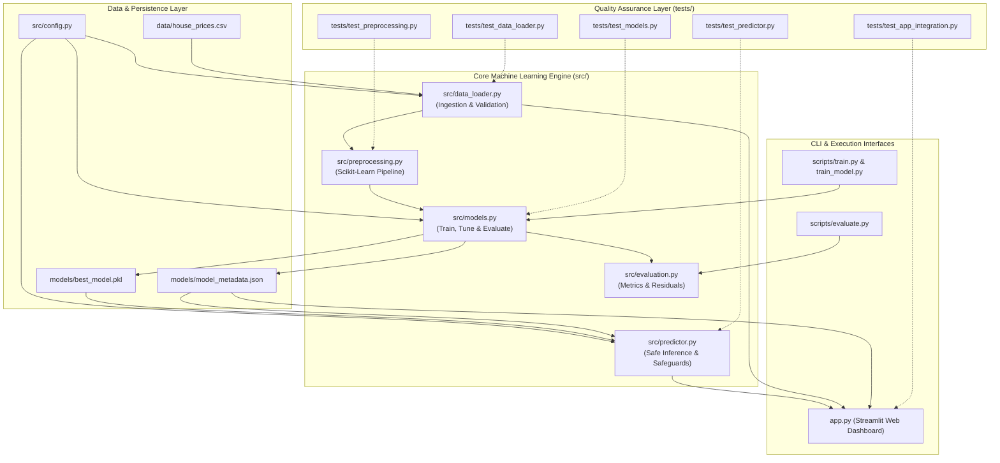
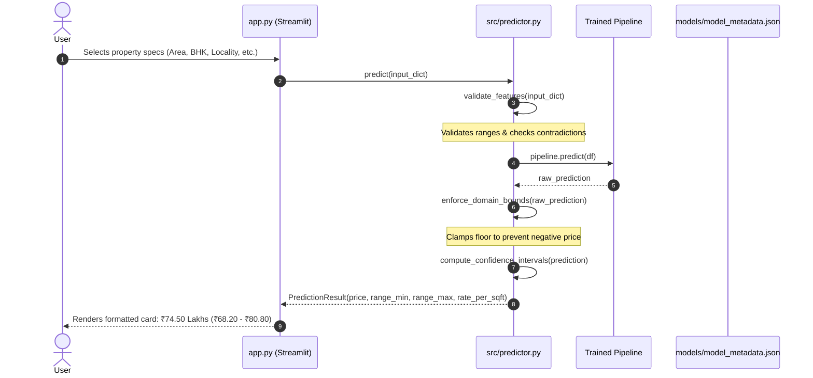

# Architecture Design Document

**Project**: House Price Prediction System (`mini-project5`)  
**Document**: Architecture & Technical Specification  
**Version**: 2.0.0  
**Status**: Target Architecture  
**Author**: Software Engineering & Architecture Team  

---

## 1. System Overview

The modernized House Price Prediction System transforms a toy machine learning script into an enterprise-ready, modular, and maintainable regression engine. The system provides:

1. **Robust Data Ingestion & Validation**: Replaces the hardcoded 10-row dataset with a structured dataset, strict schema validation, and configurable train/val/test partitioning.
2. **Multi-Model Machine Learning Engine**: Implements a modular pipeline comparing multiple algorithms (Linear Regression, Ridge, Lasso, Random Forest, Gradient Boosting) using cross-validation.
3. **Safe Inference Service**: Encapsulates model inference within an enterprise-grade `HousePricePredictor` that enforces physical domain rules (strictly positive valuations, bounding, confidence intervals, and sanity checks).
4. **Interactive Multi-View Streamlit UI**: Offers real-time single property estimation, batch CSV prediction, model performance analytics, and feature importance visualization.
5. **Reproducible Tooling & Automated Quality Gates**: Includes unit and integration tests, configuration management, and full model metadata tracking.

---

## 2. High-Level Architecture Diagram

---

## 3. Component Decomposition & Responsibilities

### 3.1 `src/config.py` (Central Configuration)
- Defines immutable application constants, directory paths, and default hyperparameters.
- Defines input feature schemas, supported categorical levels (e.g. `locality`, `furnished_status`), and numerical bounds (minimum/maximum square footage, bedroom count, age).
- Configures random seeds to guarantee 100% reproducible experiments.

### 3.2 `src/data_loader.py` (Data Ingestion & Integrity)
- Safely loads property records from CSV storage into Pandas DataFrames.
- Validates data types, identifies missing values, and checks for physical contradictions (e.g. negative area, 0 bedrooms with 5 bathrooms).
- Provides stratified train/test splitting based on price quintiles to prevent distribution skew across folds.

### 3.3 `src/preprocessing.py` (Feature Transformation Pipeline)
- Builds Scikit-Learn `ColumnTransformer` pipelines:
  - Standard scaling for numerical features (`area_sqft`, `age_years`).
  - One-hot encoding for categorical variables (`locality`, `furnished_status`).
  - Pass-through for discrete count variables (`bedrooms`, `bathrooms`, `parking`).
- Ensures zero data leakage between training and evaluation splits by fitting transformers strictly on training sets.

### 3.4 `src/models.py` (Model Management & Training)
- Evaluates candidate regression models:
  1. **Linear Regression** (Ordinary Least Squares baseline)
  2. **Ridge Regression** (L2 regularization to mitigate multicollinearity)
  3. **Lasso Regression** (L1 regularization for feature sparsity)
  4. **Random Forest Regressor** (Ensemble tree-based nonlinear estimator)
  5. **Gradient Boosting Regressor** (Sequential boosting for superior predictive accuracy)
- Executes 5-fold cross-validation and selects the best model based on root-mean-squared error (RMSE) and mean absolute percentage error (MAPE).
- Serializes the winning pipeline along with JSON metadata (training date, metrics, hyperparameters, input schema, SHA256 checksum).

### 3.5 `src/predictor.py` (Safe Inference Engine)
- Provides a clean class `HousePricePredictor` for runtime inference.
- Implements strict defensive programming:
  - Verifies presence and schema of required features.
  - Implements **physical domain floor clamping**: home prices cannot be negative. The predictor floors predictions at a realistic minimum replacement valuation ($₹5.0$ Lakhs).
  - Calculates confidence intervals (uncertainty bounds) based on residual standard deviation.
  - Computes localized price per square foot metrics.

### 3.6 `src/evaluation.py` (Evaluation & Metrics)
- Computes comprehensive regression metrics:
  - Mean Absolute Error ($\text{MAE}$)
  - Root Mean Squared Error ($\text{RMSE}$)
  - Mean Absolute Percentage Error ($\text{MAPE}$)
  - Coefficient of Determination ($R^2$)
  - Median Absolute Error ($\text{MedAE}$)
- Analyzes residual distributions and flags out-of-distribution prediction risks.

### 3.7 `app.py` (Streamlit Presentation Layer)
- Designed with modular UI tabs:
  1. **Single Property Valuation**: Interactive sliders, dropdowns, instant prediction card with confidence intervals and price per square foot.
  2. **Model Telemetry & Performance**: Displays comparative benchmark tables, residual plots, and feature coefficients/importances.
  3. **Batch Valuation**: Upload CSV containing multiple properties and download predictions.
  4. **Dataset Explorer**: Explore distributions and correlations in the benchmark dataset.

---

## 4. End-to-End Data & Inference Flow

---

## 5. Security & Reliability Architecture

1. **Pickle Safety**: Model files are accompanied by `model_metadata.json` containing SHA-256 digests. Models are loaded safely from verified project paths.
2. **Graceful Fallbacks**: If model artifacts are missing, `app.py` displays an actionable recovery UI with instructions to run `python scripts/train.py` rather than throwing an unhandled exception.
3. **Strict Validation**: Out-of-range or malicious inputs (e.g. negative numbers, script injections) are rejected during validation before passing to the model.
4. **Environment Isolation**: A proper `.gitignore` prevents virtual environments and private settings from leaking into version control.
