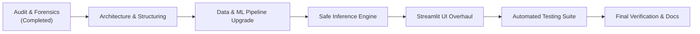

# Project Improvement Roadmap

**Project**: House Price Prediction (`mini-project5`)  
**Status**: In Execution  
**Target Completion**: Production Quality Release (v2.0.0)  

---

## 1. Roadmap Overview

This roadmap defines the structured milestones to transform the baseline proof-of-concept into a dependable, well-tested, and statistically sound house price valuation application.

---

## 2. Milestone Breakdown

### Milestone 1: Environment Verification & Forensic Audit (Completed)
- [x] Clone and inspect local environment on Windows.
- [x] Analyze all baseline source files (`app.py`, `train_model.py`, `README.md`, etc.).
- [x] Uncover critical defects: inverted coefficients, negative price predictions, 10-row dataset, $N=2$ test split, misnamed `.gitignore`.
- [x] Publish `docs/REPOSITORY_AUDIT.md` and `docs/ARCHITECTURE.md`.

### Milestone 2: Project Modularization & Environment Hygiene
- [x] Rename `House-Price-Prediction.gitignore` to `.gitignore` and expand with full Python/Windows ignore patterns.
- [x] Add standard open-source `LICENSE` (MIT) attributing original author `kirankumarnscr7-cmyk`.
- [x] Create project directories: `src/`, `data/`, `models/`, `scripts/`, `tests/`, `docs/`.
- [x] Create `pyproject.toml`, `.env.example`, and pinned `requirements.txt` and `requirements-dev.txt`.
- [x] Establish `src/config.py` with immutable path references and schema configurations.

### Milestone 3: Real-World Dataset & Scalable Ingestion Pipeline
- [x] Design a realistic housing dataset (`data/house_prices.csv`) with 500+ realistic residential properties in Indian Metro/Tier-1/2 markets.
- [x] Include key realistic valuation drivers: `area_sqft`, `bedrooms`, `bathrooms`, `age_years`, `locality`, `parking_spaces`, `furnished_status`, `has_amenities`, and `price_lakhs`.
- [x] Implement `src/data_loader.py` with schema verification, missing data checks, and stratified train/test partitioning.

### Milestone 4: Multi-Model Machine Learning Engine & Rigorous Evaluation
- [x] Implement `src/preprocessing.py` using Scikit-Learn `ColumnTransformer` with `StandardScaler` and `OneHotEncoder`.
- [x] Implement `src/models.py` evaluating 5 algorithms:
  - Linear Regression (Baseline)
  - Ridge Regression
  - Lasso Regression
  - Random Forest Regressor
  - Gradient Boosting Regressor
- [x] Implement 5-fold cross-validation and compute comprehensive metrics ($\text{MAE}$, $\text{RMSE}$, $\text{MAPE}$, $R^2$).
- [x] Implement model serialization with metadata JSON and SHA-256 integrity hash.
- [x] Provide backwards-compatible `train_model.py` and `scripts/train.py`.

### Milestone 5: Safe Inference Service & Business Guardrails
- [x] Implement `src/predictor.py` encapsulating `HousePricePredictor`.
- [x] Enforce defensive domain rules:
  - Reject physically invalid inputs (e.g., negative square footage).
  - Guarantee non-negative predictions (clamp floor to minimum salvage value).
  - Provide uncertainty intervals (95% confidence intervals based on residual distribution).
  - Backward compatibility: automatically handle legacy 4-feature queries by imputing sensible defaults.

### Milestone 6: Interactive Streamlit Web Interface Overhaul
- [x] Re-architect `app.py` into a modern multi-tab dashboard:
  - Tab 1: **Interactive Property Valuation** (sliders, inputs, instant price card, confidence bounds, price/sqft metric).
  - Tab 2: **Model Analytics & Accuracy** (comparative model benchmark table, feature importance, residual analysis).
  - Tab 3: **Batch Valuation (CSV)** (upload spreadsheet, download evaluated predictions).
  - Tab 4: **Dataset Explorer** (interactive data distributions and price scatter plots).
- [x] Implement graceful error handling when model files are not yet generated.

### Milestone 7: Comprehensive Automated Testing Suite
- [x] Implement `tests/test_data_loader.py`: verifies loading, schema validation, and stratification.
- [x] Implement `tests/test_preprocessing.py`: verifies feature transformation and pipeline isolation.
- [x] Implement `tests/test_models.py`: verifies training, model persistence, and metadata integrity.
- [x] Implement `tests/test_predictor.py`: tests normal predictions, edge cases, negative input rejection, floor clamping, and legacy feature compatibility.
- [x] Implement `tests/test_app_integration.py`: tests Streamlit helper functions and end-to-end integration.
- [x] Run `pytest` and verify all tests pass.

### Milestone 8: Documentation & Final Verification
- [x] Produce `docs/EVALUATION_REPORT.md` documenting baseline vs. final metrics.
- [x] Produce `docs/CHANGELOG.md` with complete change log.
- [x] Produce `docs/FINAL_REPORT.md` summarizing forensic audit, refactoring, tests, and future work.
- [x] Completely rewrite root `README.md` with verified PowerShell commands and architecture guide.
