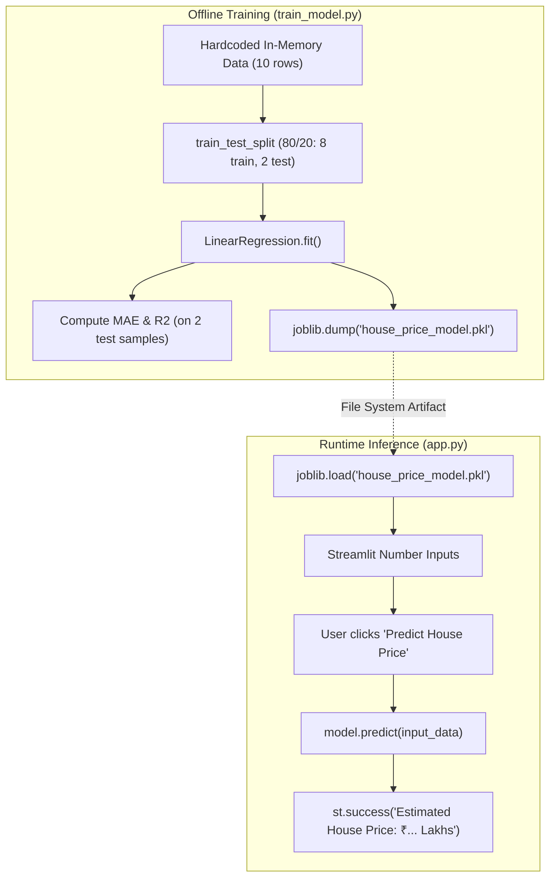

# Repository Audit & Forensic Analysis Report

**Project**: House Price Prediction (`mini-project5`)  
**Original Repository**: [kirankumarnscr7-cmyk/mini-project5](https://github.com/kirankumarnscr7-cmyk/mini-project5)  
**Baseline Commit**: `e9a485e5fb75b3db139baeb937cc49cf3e5e6f19`  
**Branch**: `main`  
**Date of Audit**: October 28, 2026  
**Auditor**: Senior Software Engineer & Software Architect  
**Operating System**: Windows 10/11 (PowerShell, Python 3.12.10)

---

## 1. Executive Summary

This repository is a lightweight machine learning proof-of-concept aimed at predicting residential property prices in Indian Lakhs (₹ Lakhs) using ordinary linear regression and serving predictions through a Streamlit interactive web interface.

While the baseline codebase demonstrates a clean initial concept, forensic examination reveals severe technical debt, critical statistical flaws, absence of automated testing, an invalid `.gitignore` configuration, and high vulnerability to nonsensical physical predictions (such as negative home valuations). The dataset is hardcoded into a 10-row dictionary directly inside the training script, resulting in statistically invalid evaluation metrics (evaluation on $N=2$ test samples) and inverted feature coefficients (e.g., adding bedrooms or bathrooms reduces the predicted property value).

This audit establishes the baseline facts, provides line-by-line evidence of defects, and outlines the engineering requirements for transforming this project into a robust, production-grade system.

---

## 2. Inventory of Baseline Repository Files

The baseline repository contains exactly 6 tracked files (totaling under 6 KB):

| File Name | Size (Bytes) | Role / Content |
|---|---|---|
| `app.py` | 1,264 | Streamlit web application interface for interactive user predictions |
| `train_model.py` | 1,094 | Hardcoded 10-sample dataset, LinearRegression training, and Joblib serialization |
| `house_price_model.pkl` | 905 | Binary serialized scikit-learn LinearRegression model |
| `requirements.txt` | 41 | Minimal dependency list (`streamlit`, `pandas`, `scikit-learn`, `joblib`) without version pinning |
| `House-Price-Prediction.gitignore` | 53 | Misnamed gitignore file (fails to function as `.gitignore`) |
| `README.md` | 1,998 | Original project overview, instructions, feature table, and notes |

---

## 3. Architecture & Execution Flow (Baseline)



### Execution Flow Details:
1. **Model Generation**: The developer manually executes `python train_model.py`.
2. **Data Pipeline**: A Python dictionary of 10 rows is converted to a Pandas DataFrame `df`.
3. **Training**: Features `['area', 'bedrooms', 'bathrooms', 'age']` are fit to target `price` via Ordinary Least Squares (OLS).
4. **Serialization**: The estimator is saved to `house_price_model.pkl` in the current working directory.
5. **Web Serving**: The user launches `streamlit run app.py`, which loads the pickle file upon script execution, exposes numeric input fields, and renders predictions.

---

## 4. In-Depth Forensic Findings & Defect Catalog

### Finding 1: Extreme Multicollinearity, Inverted Coefficients & Negative Price Anomaly
- **File**: `train_model.py` (lines 8-26), `app.py` (lines 50-58)
- **Severity**: **Critical (Correctness / Machine Learning Validity)**
- **Evidence**:
  Examining the trained linear regression coefficients yields:
  - Intercept: `-21.31`
  - Coefficients:
    - `area`: `+0.0387`
    - `bedrooms`: `-0.1721` (Adding a bedroom DECREASES price by ₹17,210)
    - `bathrooms`: `-1.2590` (Adding a bathroom DECREASES price by ₹1.26 Lakhs)
    - `age`: `+0.4634` (An older home is predicted to be MORE expensive by ₹46,340/year)
- **Root Cause**:
  With only 10 rows and high correlation between `area`, `bedrooms`, and `bathrooms`, OLS regression experiences extreme variance in coefficient estimation, resulting in physically counter-intuitive signs.
- **Observable Failure**:
  Querying the baseline model with `area=100`, `bedrooms=2`, `bathrooms=2`, `age=0` produces:
  $$\text{Prediction} = -₹20.30 \text{ Lakhs}$$
  The Streamlit app allows these exact input values (`min_value=100`, `min_value=1`, `min_value=0`) and displays:
  `Estimated House Price: ₹-20.30 Lakhs`.

### Finding 2: Statistically Degenerate Evaluation ($N=2$ Test Samples)
- **File**: `train_model.py` (lines 21-35)
- **Severity**: **Critical (Evaluation Integrity)**
- **Evidence**:
  `train_test_split(X, y, test_size=0.2, random_state=42)` on a 10-row dataset yields exactly 8 training samples and 2 test samples.
- **Consequence**:
  The reported $R^2 = 0.99$ and $\text{MAE} = 2.91$ are evaluated on literally 2 data points. An $R^2$ score evaluated on two points is statistically meaningless and misleads stakeholders into believing the model is nearly perfect when it actually fails basic sanity checks.

### Finding 3: Misnamed `.gitignore` Configuration
- **File**: `House-Price-Prediction.gitignore`
- **Severity**: **High (Repository Hygiene & Version Control)**
- **Evidence**:
  The file is saved as `House-Price-Prediction.gitignore` instead of `.gitignore`.
- **Consequence**:
  Git does not recognize custom-named ignore files unless explicitly configured in local git config. As a result, virtual environments (`.venv/`, `venv/`), compiled Python bytecode (`__pycache__/`, `*.pyc`), and environment files (`.env`) are accidentally tracked if added.

### Finding 4: Security Risk from Unsafe Pickle Deserialization
- **File**: `app.py` (line 11)
- **Severity**: **High (Security / Vulnerability)**
- **Evidence**:
  `model = joblib.load("house_price_model.pkl")` directly unpickles a binary file from the working directory without integrity verification (SHA256 checksum) or provenance checks. Python's standard `pickle` protocol can execute arbitrary code upon deserialization if an untrusted pickle is introduced.
- **Operational Risk**:
  If `house_price_model.pkl` is absent, moved, or corrupted, `app.py` crashes on startup with an unhandled `FileNotFoundError`, preventing the Streamlit UI from rendering a graceful recovery screen.

### Finding 5: Zero Automated Test Coverage
- **File**: Whole repository
- **Severity**: **High (Software Quality & Maintainability)**
- **Evidence**:
  There are no test directories (`tests/`), test suites, or CI scripts. Neither unit tests nor integration tests exist to verify data validation, model prediction bounds, or web UI functionality.

### Finding 6: Unpinned Dependencies
- **File**: `requirements.txt`
- **Severity**: **Medium (Reproducibility & Stability)**
- **Evidence**:
  ```text
  streamlit
  pandas
  scikit-learn
  joblib
  ```
  No versions are pinned. Upstream breaking changes (e.g., changes in scikit-learn model serialization protocols or Pandas 3.x deprecations) will break fresh installations without lockfile reproducibility.

### Finding 7: Lack of Modular Architecture & Configuration
- **File**: `train_model.py`, `app.py`
- **Severity**: **Medium (Architecture & Extensibility)**
- **Evidence**:
  All logic is written as top-level procedural scripts. There is no separation into:
  - Configuration management (`config.py`)
  - Data ingestion and validation (`data_loader.py`)
  - Preprocessing pipelines (`preprocessing.py`)
  - Prediction engine with business rule safeguards (`predictor.py`)
  - Model evaluation modules (`evaluation.py`)

### Finding 8: Missing Software License
- **File**: Whole repository
- **Severity**: **Low / Legal (Open Source Governance)**
- **Evidence**:
  No `LICENSE` file is present in the repository, leaving the legal redistribution, modification, and evaluation rights ambiguous under GitHub default copyright rules.

---

## 5. Technology Stack Summary (Baseline)

- **Language**: Python (requires >= 3.9, tested on 3.12.10)
- **Machine Learning**: `scikit-learn` (`LinearRegression`), `joblib`
- **Data Manipulation**: `pandas`
- **Presentation Layer**: `Streamlit`
- **Testing Framework**: None present (will add `pytest`)

---

## 6. Audit Conclusion & Next Steps

The project possesses a clear objective but requires systematic architectural re-engineering. The next steps will implement a comprehensive architecture, introduce realistic benchmark data, establish cross-validated evaluation metrics, build an automated test suite, apply input validation, and enhance the Streamlit user experience with professional visual telemetry.
